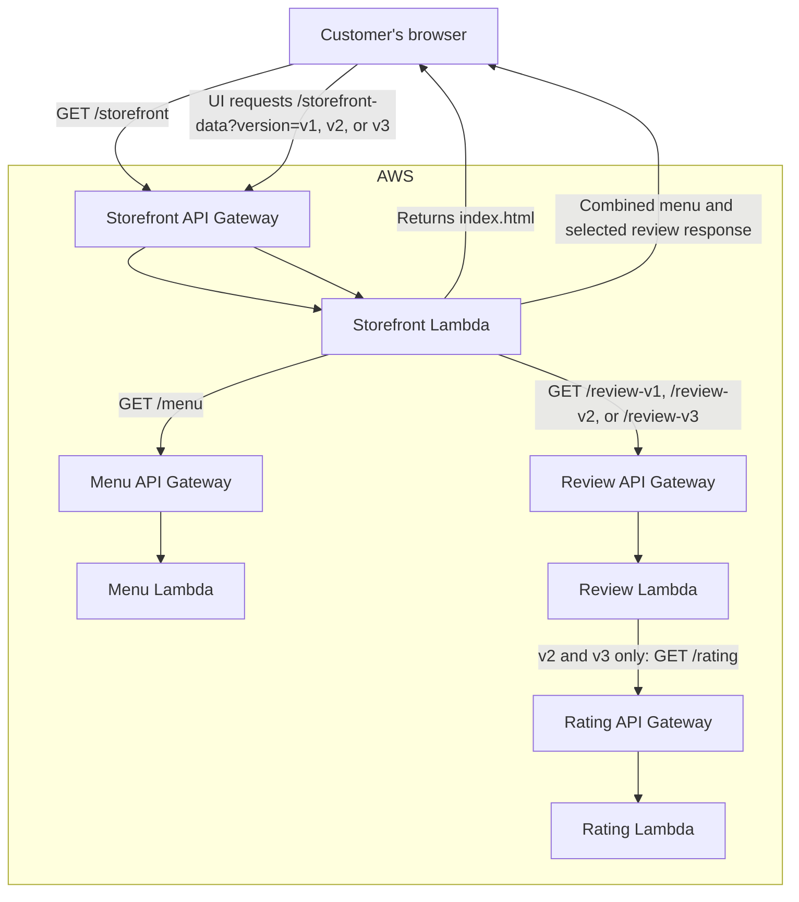

# Coffee Shop — Manual Serverless Orchestration

This project demonstrates a multi-service coffee-shop application deployed as
independent AWS Lambda and API Gateway services with the Serverless Framework.
Service URLs are passed manually during deployment; this project intentionally
does not use Serverless Compose.

Deploy the services one at a time in dependency order. Each deployment prints
an endpoint URL that you must provide when deploying its dependent service.
Likewise, remove the deployed services individually with `serverless remove`;
this project has no single command that deploys or removes the whole stack.

## Architecture



The storefront serves the UI and aggregates menu and selected review data.
Review v1 returns reviews without ratings; v2 and v3 call the rating service
and include ratings. The menu UI filters the menu by category.

## Services

| Directory | API routes | Depends on |
| --- | --- | --- |
| [`rating-app/`](./rating-app/) | `GET /rating` | — |
| [`review-app/`](./review-app/) | `GET /review-v1`, `/review-v2`, `/review-v3` | Rating API for v2/v3 |
| [`menu-app/`](./menu-app/) | `GET /menu` | — |
| [`storefront/`](./storefront/) | `GET /storefront`, `GET /storefront-data` | Menu API and Review API |

Each service has its own `serverless.yml` and deploys independently. Deploy
services in dependency order and pass the API URLs printed by Serverless into
the next deployment.

The review service exposes all three versions through routes on the same HTTP
API base URL: `/review-v1`, `/review-v2`, and `/review-v3`. Configure that base
URL once as `REVIEWS_SERVICE_URL`; the storefront appends the selected route.
Use base URLs without route paths for both `MENU_SERVICE_URL` and
`REVIEWS_SERVICE_URL`.

## Prerequisites

- Node.js 24 or newer
- AWS credentials configured for the target account (for example, through the
  AWS CLI profile or environment variables)
- Serverless Framework v4 installed and available as the `serverless` command

Confirm AWS credentials before deploying:

```bash
aws sts get-caller-identity
```

## Deploy services one by one

Run each command from the project root, in the order shown. After deploying a
service, copy its endpoint URL from the output into the next dependent
service's command. Keep API base URLs free of a trailing slash.

### 1. Deploy the rating API

```bash
cd rating-app
serverless deploy --stage dev --region us-east-1
cd ..
```

Record its HTTP API base URL, for example
`https://<rating-api-id>.execute-api.us-east-1.amazonaws.com`.

### 2. Deploy review with the rating route URL

`RATINGS_URL` must be the complete rating route URL (including `/rating`):

```bash
cd review-app
RATINGS_URL="https://<rating-api-id>.execute-api.us-east-1.amazonaws.com/rating" \
  serverless deploy --stage dev --region us-east-1
cd ..
```

Record the review API base URL.

### 3. Deploy the menu API

```bash
cd menu-app
serverless deploy --stage dev --region us-east-1
cd ..
```

Record the menu API base URL.

### 4. Deploy the storefront with menu and review base URLs

```bash
cd storefront
MENU_SERVICE_URL="https://<menu-api-id>.execute-api.us-east-1.amazonaws.com" \
REVIEWS_SERVICE_URL="https://<review-api-id>.execute-api.us-east-1.amazonaws.com" \
  serverless deploy --stage dev --region us-east-1
```

Open the storefront endpoint printed by Serverless with `/storefront` appended:

```text
https://<storefront-api-id>.execute-api.us-east-1.amazonaws.com/storefront
```

The environment variables are resolved during deployment and configured on the
corresponding Lambda functions. If a downstream API URL changes, redeploy its
consumer with the updated URL.

## Verify the APIs

Use the deployed API base URLs:

```bash
curl "https://<menu-api-id>.execute-api.us-east-1.amazonaws.com/menu"
curl "https://<review-api-id>.execute-api.us-east-1.amazonaws.com/review-v1"
curl "https://<review-api-id>.execute-api.us-east-1.amazonaws.com/review-v2"
curl "https://<review-api-id>.execute-api.us-east-1.amazonaws.com/review-v3"
curl "https://<rating-api-id>.execute-api.us-east-1.amazonaws.com/rating"
curl "https://<storefront-api-id>.execute-api.us-east-1.amazonaws.com/storefront-data?version=v3"
```

The storefront data endpoint accepts `version=1`, `version=2`, or `version=3`
(the `v1`, `v2`, and `v3` spellings are accepted too). Invalid versions return
HTTP 400. Downstream failures return HTTP 502.

## Remove services one by one

There is no Compose stack removal for this project. Run `serverless remove`
separately for every service, using the same stage and region used to deploy.
Remove consumers before their dependencies:

```bash
cd storefront && serverless remove --stage dev --region us-east-1 && cd ..
cd review-app && serverless remove --stage dev --region us-east-1 && cd ..
cd menu-app && serverless remove --stage dev --region us-east-1 && cd ..
cd rating-app && serverless remove --stage dev --region us-east-1 && cd ..
```

## Production considerations

The example APIs are public and use in-memory sample data. Before production
use, add authentication and authorization, restrictive CORS settings, service
timeouts/retries and monitoring, and an appropriate persistent data store.
Avoid committing AWS credentials or deployment-specific URLs to source
control.
